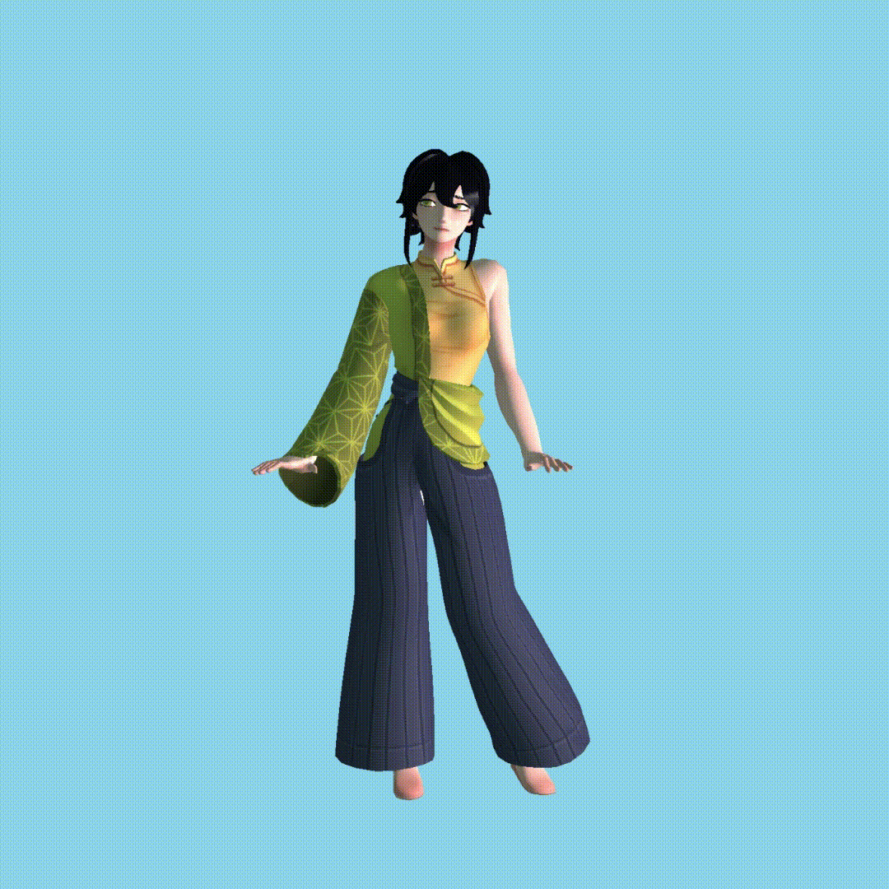

# OpenGL Renderer

A small OpenGL project created for learning computer graphics and the fundamentals of real-time rendering. The project was heavily guided by the tutorials from [LearnOpenGL](https://learnopengl.com/), with some experimentation and modifications as I worked through the concepts.

## Features

- OpenGL 3.3 Core
- Custom shader class
- Camera movement with keyboard and mouse controls
- Model, view, and projection transformations
- Blinn-Phong lighting
- Directional, point, and spot lights
- Diffuse and specular textures
- Indexed rendering with VAOs, VBOs, and EBOs
- 3D model loading with Assimp
- Support for models containing multiple meshes and materials
- Automatic loading and binding of model textures
- Basic support for OBJ/MTL materials

## Libraries

- **GLFW** – window creation and input
- **GLAD** – OpenGL function loading
- **GLM** – vectors and matrix math
- **stb_image** – texture loading
- **Assimp** – importing 3D models

The goal of this project is primarily to understand how the individual parts of a basic OpenGL renderer work rather than to build a complete rendering engine.
